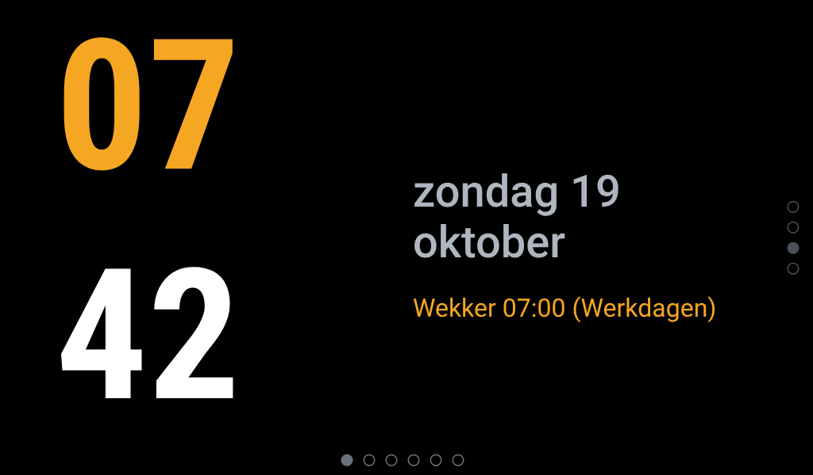
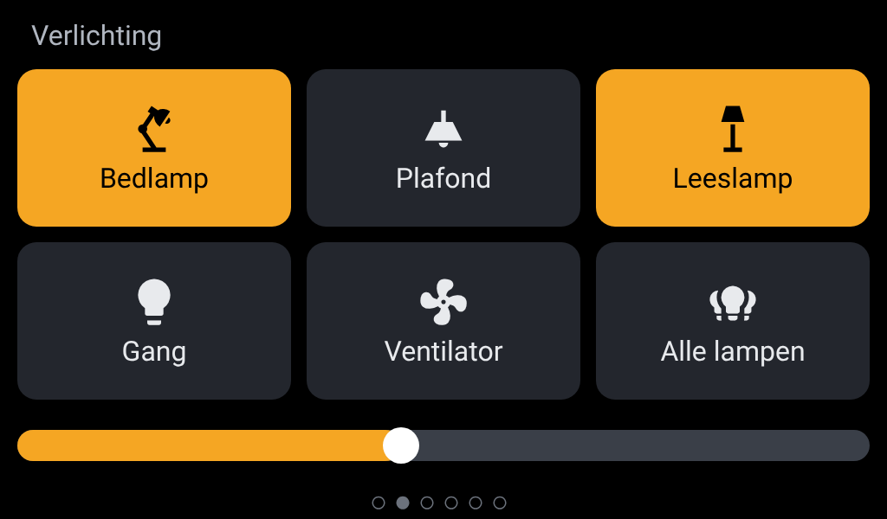

# Alarmklok + domotica-controller

Een wekker voor op het nachtkastje die tegelijk je Home Assistant bedient.
Gebouwd met [ESPHome](https://esphome.io) en LVGL. Er zijn twee versies:

| | 7" | 4" |
|---|---|---|
| Bord | Waveshare **ESP32-P4-WIFI6-Touch-LCD-7B** | Waveshare **ESP32-S3-Touch-LCD-4** (hetzelfde als in de Bosun-bootmonitor) |
| Scherm | 1024×600, liggend | 480×480, vierkant |
| Geluid | Speaker: melodieën, radio, TTS, langzaam luider | Zoemer: piepjes in een ritme; radio via een speaker in Home Assistant |
| Tijd zonder wifi | Na een herstart pas weer met wifi | Klokchip (RTC) houdt de tijd vast |
| Configuratie | `esphome/alarmklok.yaml` | `esphome/alarmklok-4inch.yaml` |

Beide versies hebben dezelfde pagina's, wekkers en instellingen. De 4"-versie
is **nog niet op het echte bord getest**; zie [Bekende aandachtspunten](#bekende-aandachtspunten).


## Bediening: swipen zoals de iPhone-slaapmodus

| Gebaar | Wat gebeurt er |
|---|---|
| **Links/rechts swipen** | Bladeren tussen Klok → Verlichting → Klimaat & rolluik → Muziek → Scènes → Wekker |
| **Omlaag/omhoog swipen op de klok** | Ander klokontwerp: Digitaal, Analoog, Gestapeld of Info. De keuze wordt onthouden. |
| 30 s niets aanraken | Terug naar de klok |

De stippen onderaan geven aan op welke pagina je bent; de stippen rechts op de
klok geven aan welk klokontwerp actief is. Je kunt het ontwerp ook vanuit Home
Assistant kiezen met `select.alarmklok_klokontwerp`.

## Wat kan hij?

| | |
|---|---|
|  |  |
| **Digitaal:** grote tijd, datum, temperatuur, volgende wekker | **Analoog:** wijzerplaat met secondewijzer, info ernaast |
|  |  |
| **Gestapeld:** uren boven minuten, zoals StandBy | **Info:** tijd met kaarten voor weer, wekker en wake-up light |
|  |  |
| **Verlichting:** 6 tegels (oranje = aan) en een dimschuif | **Klimaat & rolluik:** thermostaat ± 0,5° en rolluik open/stop/dicht/positie |
|  |  |
| **Muziek:** wat er speelt, bediening, volume en 3 radiozenders | **Scènes:** 6 knoppen voor scènes en scripts |
|  |  |
| **Wekker:** drie wekkers (1/2/3) met elk een eigen tijd, aan/uit en dagen; geluid, volume, langzaam luider, wake-up light | **Wekker gaat af:** grote Snooze-knop; Stop moet je lang indrukken |

> De screenshots zijn **ontwerpweergaven**, nagebouwd met dezelfde maten,
> lettertypen, iconen en kleuren als de LVGL-configuratie, met voorbeelddata.
> Het echte scherm kan op kleine details afwijken. De wekkerpagina heeft
> inmiddels bovenaan de knoppen 1/2/3 en onderaan de schakelaar "Langzaam
> luider"; die staan nog niet op de screenshot.

Verder:

- **Nachtstand** ([screenshot](docs/screenshots/11-nachtstand.png)):
  tussen twee instelbare tijden wordt het scherm gedimd en worden alle cijfers
  donkerrood. De eerste tik wekt alleen het scherm, zodat je in het donker niet
  per ongeluk een lamp aanzet.
- **Drie wekkers:** elk met een eigen tijd, aan/uit en dagen: elke dag,
  werkdagen, weekend, één vaste dag (bijvoorbeeld alleen dinsdag) of
  **eenmalig** (gaat één keer af en zet zichzelf daarna uit). Kies op de
  wekkerpagina met 1/2/3 welke je instelt. De klokschermen tonen de
  eerstvolgende, bijvoorbeeld "Wekker morgen 07:00" of "Wekker ma 07:15".
- **Langzaam luider:** het wekgeluid (melodie of radio) begint op 10% en loopt
  in 60 seconden op tot het wekvolume. De duur stel je in met *Wekgeluid
  oplopen* in Home Assistant (0 = meteen vol).
- **Wake-up light:** een instelbaar aantal minuten voor de wektijd laat Home
  Assistant de bedlamp langzaam opkomen, als een zonsopgang.
- **Wekgeluid:** drie ingebouwde melodieën, of **Radio**: dan speelt Home
  Assistant een radiostream af via de speaker van de klok. Speelt er na 20 s
  nog niets, dan valt de klok terug op het gewone wekgeluid.
- **Speaker in Home Assistant:** de klok verschijnt als mediaspeler, dus je kunt
  er ook muziek, radio of TTS-meldingen naartoe sturen.
- **Werkt zonder Home Assistant:** de tijd komt via NTP en de wekker draait op
  de klok zelf. Als HA plat ligt, gaat de wekker gewoon af.

## Benodigdheden

| Onderdeel | Opmerking |
|---|---|
**7":**

| Onderdeel | Opmerking |
|---|---|
| Waveshare ESP32-P4-WIFI6-Touch-LCD-7B | Versie zonder camera is genoeg |
| Kleine speaker (4–8 Ω, 2–3 W) | Op de speakeraansluiting van het bord |
| USB-C-voeding (5 V, 2 A) | |
| Behuizing / standaard | Bijvoorbeeld 3D-geprint |

**4":**

| Onderdeel | Opmerking |
|---|---|
| Waveshare ESP32-S3-Touch-LCD-4, touchversie | Board V3 en V4 werken allebei |
| Oplaadbare RTC-cel ML2032 of ML2020 met JST-SH-stekker | Aangeraden: houdt de tijd vast zonder stroom. Nooit een gewone CR2032 |
| USB-C-voeding (5 V, 2 A) of 12 V op de schroefklem | |

> **Later een 4" mét speaker?** De Waveshare **ESP32-P4-WIFI6-Touch-LCD-4B**
> (720×720, ook verkocht als ESP32-P4-86-Panel-ETH-2RO) heeft een speaker-
> aansluiting en dezelfde audiochip als de 7". De vierkante schermindeling
> schaalt al mee (`k: "1.5"`); er is dan alleen nog een hardwarebestand nodig.

## Mappen

```
esphome/
  alarmklok.yaml                 De 7"-klok (dit flash je)
  alarmklok-4inch.yaml           De 4"-klok (dit flash je)
  instellingen.yaml              Standaardwaarden voor tegels en pagina's (hier pas je dingen aan)
  alarmklok.h                    Hulpfuncties in C++ (datum, wekdagen, volgende wekker, iconen)
  secrets.yaml.example           Voorbeeld voor je wifi-gegevens en sleutels
  onderdelen/
    kern.yaml                    Wekkers, instellingen en logica (gedeeld door beide klokken)
    waveshare-p4-7b.yaml         Hardware 7": scherm, touch, backlight, audio, wifi
    waveshare-s3-4.yaml/.h       Hardware 4": scherm, touch, hulpchip, zoemer, klokchip
    scherm.yaml                  De touch-interface voor 7" (swipe-pagina's, klokontwerpen)
    scherm-vierkant.yaml         De touch-interface voor vierkante schermen (schaalt met k)
    ha-bediening.yaml            Haalt thermostaat, rolluik en muziek uit HA
    wekker.yaml                  Eén wekker: tijd, aan/uit en dagen
    tegel.yaml                   Eén bedieningstegel op het scherm
    tegel-instellingen.yaml      Naam, entiteit en icoon van een tegel (in te stellen vanuit HA)
    radio-knop.yaml              Eén radiozender-knop
docs/screenshots/                Ontwerpweergaven van alle schermen
homeassistant/
  packages/alarmklok.yaml        Automations: wake-up light, radio, goedemorgen
  dashboard-kaart.yaml           Kaart voor je HA-dashboard
espcontrol-port/                 Patch om dit scherm aan EspControl toe te voegen
```

## Installatie

### 1. Firmware op de klok zetten

1. Installeer de **ESPHome Device Builder**-add-on in Home Assistant, of
   `pip install esphome` op je computer.
2. Kopieer de map `esphome/` naar je ESPHome-configuratiemap. In de add-on is
   dat `/config/esphome/`. Houd de map `onderdelen/` erbij.
3. Maak `secrets.yaml` aan op basis van `secrets.yaml.example` en vul je wifi
   in. Een API-sleutel maak je zo aan:
   ```
   python3 -c "import secrets,base64;print(base64.b64encode(secrets.token_bytes(32)).decode())"
   ```
4. Pas in `instellingen.yaml` het blok `substitutions:` aan: lampen,
   thermostaat, rolluik, mediaspeler, radiozenders, scènes en de
   temperatuursensor. Dit geldt voor beide klokken; iets alleen voor één klok
   zet je in de `substitutions:` van `alarmklok.yaml` of `alarmklok-4inch.yaml`.
5. De eerste keer flash je via USB-C:
   `esphome run alarmklok.yaml` (7") of `esphome run alarmklok-4inch.yaml` (4"),
   of in de add-on via *Install → Plug into this computer*. Daarna gaat het
   draadloos (OTA).

> **Chiprevisie:** de configuratie gaat uit van een productiechip (rev3). Toont
> het bootlog `chip revision: v1.x`? Zet dan in
> `onderdelen/waveshare-p4-7b.yaml` de optie `engineering_sample: true`.

> **4": beeld op z'n kop?** In de Bosun-behuizing zit het scherm 180° gedraaid.
> Zet dan in `alarmklok-4inch.yaml` onder `substitutions:` de regel
> `draaiing: "180"`. De touch draait mee.

### 2. Koppelen aan Home Assistant

1. HA vindt de klok vanzelf (*Instellingen → Apparaten & diensten*). Voer bij
   het koppelen de API-sleutel in.
2. Open bij de ESPHome-integratie de **opties van de klok** en zet
   **"Sta het apparaat toe Home Assistant-acties uit te voeren"** aan.
   Zonder deze optie doen de tegels en de dimschuif niets.

### 3. Home Assistant-pakket

1. Zet in `configuration.yaml`:
   ```yaml
   homeassistant:
     packages: !include_dir_named packages
   ```
2. Kopieer `homeassistant/packages/alarmklok.yaml` naar `/config/packages/`.
3. Pas de entiteiten in de `variables:`-blokken aan: bedlamp, rolluik en
   radiostream.
4. Herstart Home Assistant.

### 4. Dashboard (optioneel)

Dashboard bewerken → *Kaart toevoegen* → *Handmatig* → plak de inhoud van
`homeassistant/dashboard-kaart.yaml`.

## Entiteiten in Home Assistant

| Entiteit | Wat |
|---|---|
| `time.alarmklok_wekker_1_tijd` (ook `_2_`, `_3_`) | Tijd van wekker 1, 2 en 3 |
| `switch.alarmklok_wekker_1_aan` (ook `_2_`, `_3_`) | Wekker aan/uit |
| `select.alarmklok_wekker_1_dagen` (ook `_2_`, `_3_`) | Elke dag / Werkdagen / Weekend / Eenmalig / Maandag … Zondag |
| `select.alarmklok_wekgeluid` | Klassiek / Zacht / Mario / Radio (voor alle wekkers) |
| `number.alarmklok_wekvolume` | Volume van het wekgeluid |
| `number.alarmklok_wekgeluid_oplopen` | In zoveel seconden van zacht naar het wekvolume (0 = uit) |
| `number.alarmklok_snooze_duur` | Snooze in minuten |
| `number.alarmklok_wake_up_light_vooraf` | Minuten voor de wektijd dat het licht begint (0 = uit) |
| `time.alarmklok_nachtstand_vanaf` / `_tot` | Venster voor de nachtstand |
| `number.alarmklok_helderheid_overdag` / `_s_nachts` | Schermhelderheid |
| `light.alarmklok_schermhelderheid` | Backlight rechtstreeks |
| `select.alarmklok_klokontwerp` | Digitaal / Analoog / Gestapeld / Info |
| `sensor.alarmklok_wekker_status` | Wacht / Gaat af / Snooze |
| `button.alarmklok_snooze`, `button.alarmklok_wekker_stoppen`, `button.alarmklok_wekker_testen` | Bediening op afstand |
| `text.alarmklok_tegel_verlichting_1_naam`, `…_entiteit`, `select.…_icoon` (1–6, en `tegel_scene_1` t/m `6`) | Tegels instellen, zie hieronder |
| `media_player.alarmklok_speaker` | Speaker voor muziek, radio en TTS |

### Events voor eigen automations

| Event | Data |
|---|---|
| `esphome.alarmklok_wakeup` | `minuten`: duur van het wake-up light, `klok`: welke klok |
| `esphome.alarmklok_wekker` | `status`: `gaat_af`, `snooze` of `gestopt`, `klok`: welke klok, en bij `gaat_af` ook `geluid` |

`klok` is de `name` uit de configuratie: `alarmklok` (7") of `alarmklok-4inch`
(4"). De entiteiten van de 4"-klok heten `…alarmklok_4_inch_…`, bijvoorbeeld
`time.alarmklok_4_inch_wekker_1_tijd`.

**Radio op de 4"-klok:** die heeft geen speaker. Zet in
`homeassistant/packages/alarmklok.yaml` bij `speakers:` welke speaker de radio
voor `alarmklok-4inch` afspeelt (staat op `media_player.slaapkamer`). De klok
kan niet horen of de radio speelt: na 60 s piept hij als vangnet ook. Snooze of
stop zet de radio weer uit.

## Pagina's aanpassen

### Tegels: vanuit Home Assistant, zonder flashen

De 6 tegels op *Verlichting* en de 6 knoppen op *Scènes* stel je in Home
Assistant in: *Instellingen → Apparaten & diensten → ESPHome → Alarmklok*,
kopje **Configuratie**. Per tegel zijn er drie instellingen:

| Instelling | Wat | Wanneer zichtbaar |
|---|---|---|
| *Tegel verlichting 1 naam* | Tekst onder het icoon | Meteen |
| *Tegel verlichting 1 icoon* | Kies uit de lijst hieronder | Meteen |
| *Tegel verlichting 1 entiteit* | Bijvoorbeeld `light.bedlamp`; leeg = tegel verbergen | Na ~10 s: de klok herstart even om de nieuwe entiteit te volgen |

De herstart wacht als er een wekker afgaat of snoozet. Je instellingen blijven
bewaard, ook na een nieuwe firmware.

Tegels op de pagina Verlichting doen een `toggle` (werkt met `light`,
`switch`, `fan`, `cover`, `input_boolean` en dergelijke). Scèneknoppen doen
`turn_on` (werkt met `scene`, `script` en `automation`).

### Overige pagina's en standaardwaarden

De rest staat bovenin `esphome/alarmklok.yaml`. Daar staan ook de
**standaardwaarden** van de tegels, die gelden totdat je ze in Home Assistant
verandert:

```yaml
  # Verlichting (standaard; daarna aanpassen in HA)
  licht_1_naam: Bedlamp
  licht_1_entity: light.slaapkamer
  licht_1_icoon: desk-lamp
  dim_lamp: light.slaapkamer     # voor de dimschuif

  # Klimaat & rolluik
  thermostaat: climate.slaapkamer
  rolluik: cover.slaapkamer

  # Muziek
  mediaspeler: media_player.alarmklok_speaker
  radio_1_naam: NPO Radio 2
  radio_1_url: https://icecast.omroep.nl/radio2-bb-mp3
```

Na een wijziging in dit bestand moet je de klok opnieuw flashen. Dat gaat
draadloos.

### Beschikbare iconen

`lightbulb`, `lightbulb-on`, `lightbulb-group`, `ceiling-light`, `floor-lamp`,
`desk-lamp`, `lamp`, `blinds`, `window-shutter`, `roller-shade`, `curtains`,
`music`, `radio`, `radio-tower`, `speaker`, `television`, `movie-open`, `fan`,
`radiator`, `thermostat`, `power-sleep`, `weather-night`, `weather-sunset-up`,
`home`, `sofa`, `bed`, `silverware-fork-knife`, `lightning-bolt`.

Ze zien eruit zoals op [Material Design Icons](https://pictogrammers.com/library/mdi/).
Wil je een ander icoon? Dan moet het op drie plekken bij: de lijst `glyphs:` van
het font `f_icoon` in `onderdelen/scherm.yaml`, de functie `icoon()` in
`alarmklok.h` en de `options:` in `onderdelen/tegel-instellingen.yaml`.

## Bekende aandachtspunten

- Deze configuratie compileert volledig met `esphome compile` (ESPHome 2026.9.1),
  **nog niet op echte hardware getest**. Bij de eerste keer flashen kan er nog
  iets bijgesteld moeten worden.
- **Touch omgekeerd of gespiegeld?** Voeg in `onderdelen/waveshare-p4-7b.yaml`
  onder `touchscreen:` een `transform:` toe (`mirror_x`, `mirror_y`,
  `swap_xy`).
- **Wifi:** loopt via de ESP32-C6 op het bord, met de standaard SDIO-pinnen van
  Espressif voor de ESP32-P4. Komt er geen wifi-verbinding? Controleer dan de
  pinnen onder `esp32_hosted:`, en of de firmware van de C6 actueel is.
- **Flash:** het bord heeft 32 MB, maar de configuratie gebruikt 16 MB, omdat
  OTA met 32 MB in ESPHome nog experimenteel is.

### 4"-klok (Waveshare ESP32-S3-Touch-LCD-4)

- Compileert met ESPHome 2026.9.1, maar is **nog niet op het bord getest**.
  Scherm, touch, hulpchip en klokchip volgen de pinnen en registers die in de
  Bosun-bootmonitor op hetzelfde bord werken.
- **Board V3 (TCA9554):** de backlight kan daar alleen aan of uit. Dimmen en
  de nachtstand-helderheid werken alleen op board V4 (CH32V003).
- **Zwart scherm?** Dan heeft de hulpchip scherm of touch niet uit reset
  gehaald. Het log zegt bij het opstarten welke hulpchip gevonden is.
- **Wekgeluid:** de zoemer piept in een ritme per wekgeluid (Klassiek,
  Zacht, Mario). *Wekvolume* heeft geen effect; *langzaam luider* begint met
  lange pauzes tussen de piepjes.
- **Pagina Wekker:** past niet op één scherm. Veeg omhoog voor volume,
  wake-up light, *Test wekker* en *Langzaam luider*.
