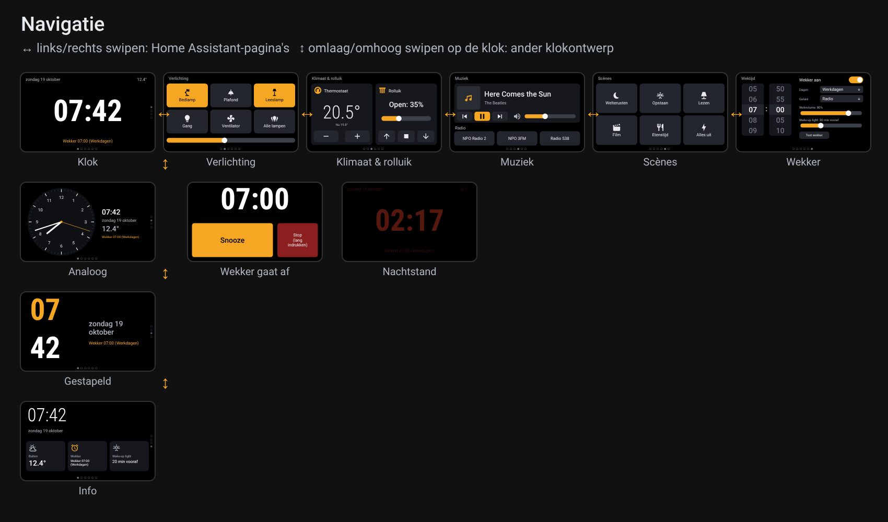
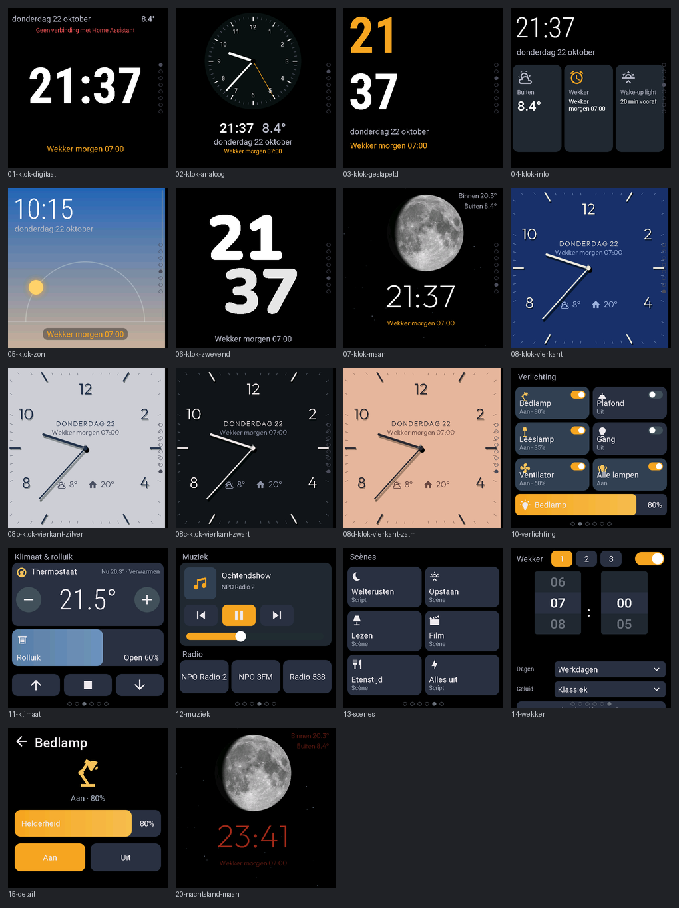
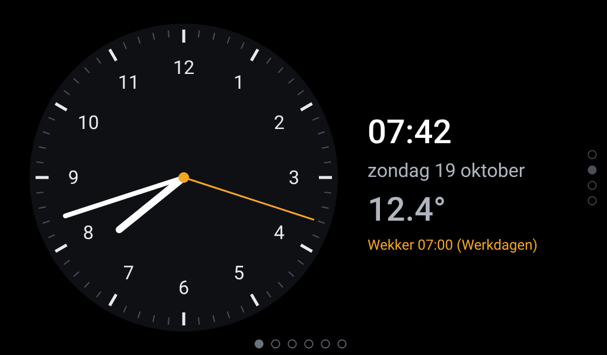
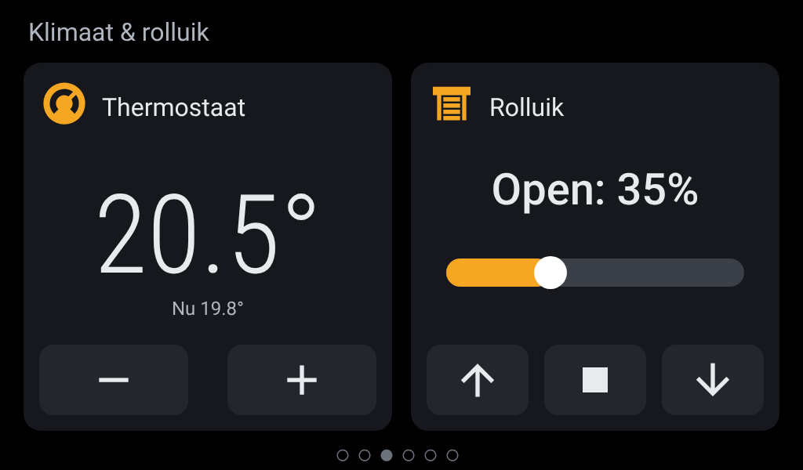
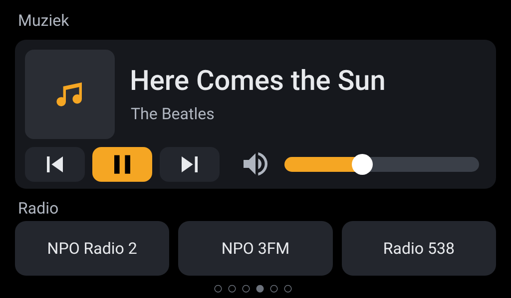
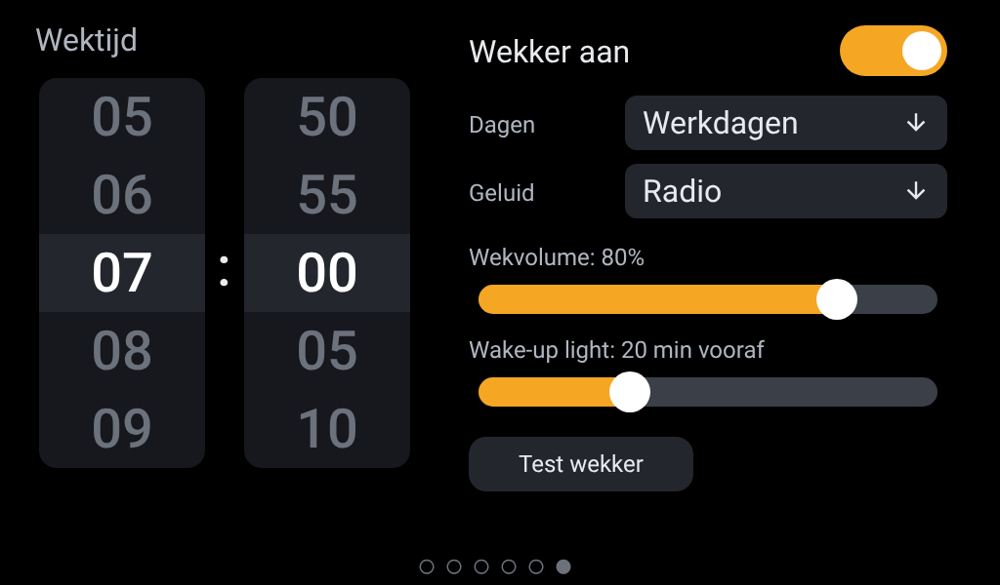
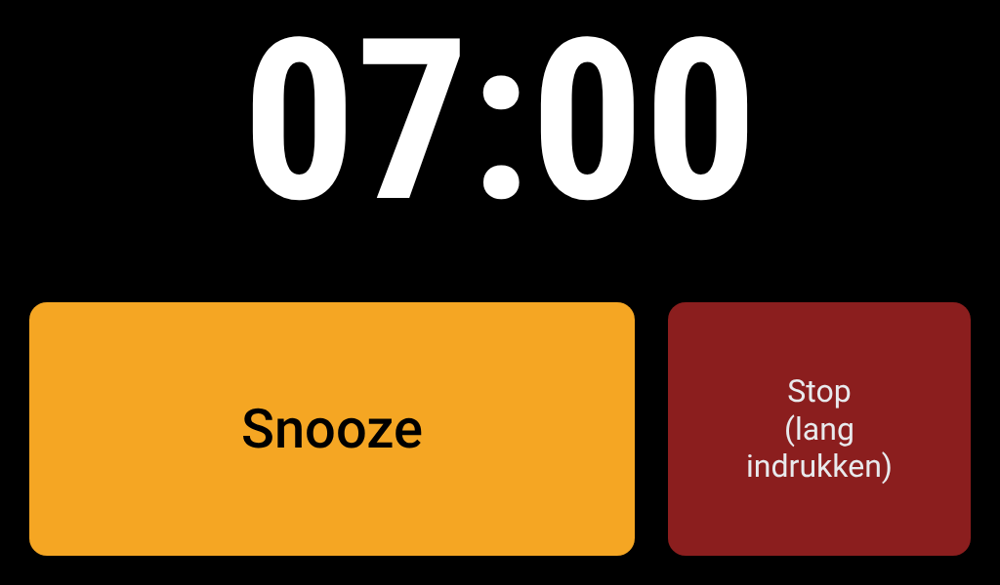
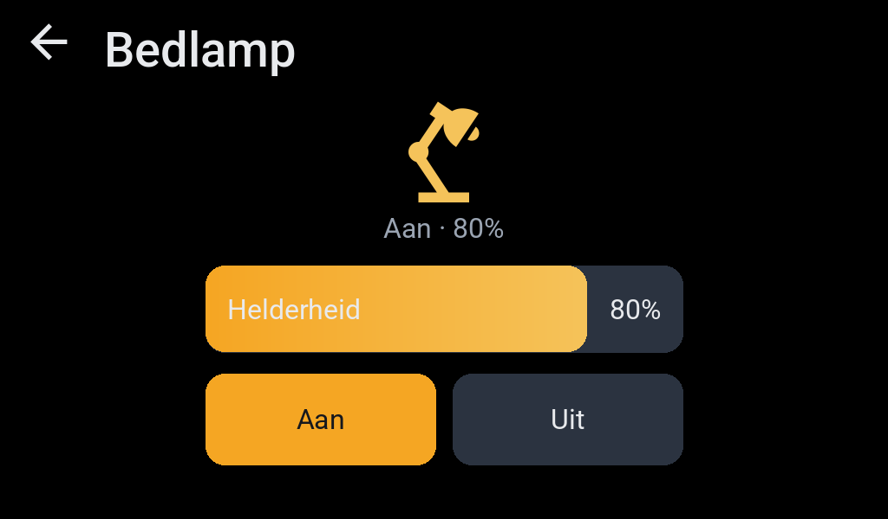

# Alarmklok + domotica-controller

Een wekker voor op het nachtkastje die tegelijk je Home Assistant bedient.
Gebouwd met [ESPHome](https://esphome.io) en LVGL. Er zijn drie versies:

| | 7" | 4B | 4" (Bosun-bord) |
|---|---|---|---|
| Bord | Waveshare **ESP32-P4-WIFI6-Touch-LCD-7B** | Waveshare **ESP32-P4-WIFI6-Touch-LCD-4B** (ook: ESP32-P4-86-Panel-ETH-2RO) | Waveshare **ESP32-S3-Touch-LCD-4** (zoals in de Bosun-bootmonitor) |
| Scherm | 1024×600, liggend | 720×720, vierkant | 480×480, vierkant |
| Geluid | Speaker: melodieën, radio, TTS, langzaam luider | Speaker, zoals de 7" | Zoemer; radio via een speaker in HA |
| Spraakassistent | ✅ microfoons | ✅ microfoons | ❌ geen microfoon |
| Tijd zonder wifi | Pas weer met wifi of HA | Pas weer met wifi of HA | Klokchip (RTC) houdt de tijd vast |
| Extra | | Twee relais | |
| Configuratie | `esphome/alarmklok.yaml` | `esphome/alarmklok-4b.yaml` | `esphome/alarmklok-4inch.yaml` |

**De 4"-klok is het primaire scherm** (nu het Bosun-bord, later de 4B): nieuwe
functies worden eerst voor het vierkante scherm ontworpen en getest, de 7"
volgt. Zie [Ontwikkelen](#ontwikkelen).

Alle versies hebben dezelfde pagina's, wekkers en instellingen. Ze compileren,
maar zijn **nog niet op de echte borden getest**; zie [Bekende aandachtspunten](#bekende-aandachtspunten).



## Bediening: swipen zoals de iPhone-slaapmodus

| Gebaar | Wat gebeurt er |
|---|---|
| **Links/rechts swipen** | Bladeren tussen Klok → Verlichting → Klimaat & rolluik → Muziek → Scènes → Wekker |
| **Omlaag/omhoog swipen op de klok** | Ander klokontwerp: Digitaal, Analoog, Gestapeld, Info, Zon, Zwevend, Maan of Vierkant. De keuze wordt onthouden. |
| **Lang drukken op de klok** | Volgende klokkleur (wit, warm, oranje, rood, roze, paars, blauw, groen), zoals StandBy op de iPhone |
| **Lang drukken op een verlichtingstegel** | Detailpagina: groot icoon, status, schuif voor helderheid (of positie/snelheid) en knoppen Aan/Uit. Terug met de pijl. |
| 30 s niets aanraken | Terug naar de klok |

De stippen onderaan geven aan op welke pagina je bent; de stippen rechts op de
klok geven aan welk klokontwerp actief is. Je kunt het ontwerp ook vanuit Home
Assistant kiezen met `select.alarmklok_klokontwerp`.

## Wat kan hij?

**Echte schermafdrukken van de 4"-klok** (480×480), rechtstreeks uit de
LVGL-configuratie op de computer gemaakt (`tools/afdrukken.sh`, zie
[Ontwikkelen](#ontwikkelen)); GitHub Actions maakt ze bij elke push opnieuw:



De losse afdrukken staan in `docs/screenshots/4inch/`. De tabel hieronder
toont oudere ontwerpweergaven van de 7".

| | |
|---|---|
|  |  |
| **Digitaal:** grote tijd, datum, temperatuur, volgende wekker | **Analoog:** wijzerplaat met secondewijzer, info ernaast |
|  |  |
| **Gestapeld:** uren boven minuten, zoals StandBy | **Info:** tijd met kaarten voor weer, wekker en wake-up light |
|  |  |
| **Verlichting:** 6 tegels met status ("Aan · 80%") en schakelaartje, plus een dimmerkaart | **Klimaat & rolluik:** thermostaatkaart met − / + en rolluikkaart (vulling = positie) |
|  |  |
| **Muziek:** wat er speelt, bediening, volume en 3 radiozenders | **Scènes:** 6 knoppen voor scènes en scripts |
|  |  |
| **Wekker:** drie wekkers (1/2/3) met elk een eigen tijd, aan/uit en dagen; geluid, volume, langzaam luider, wake-up light | **Wekker gaat af:** grote Snooze-knop; Stop moet je lang indrukken |
|  | |
| **Detailpagina:** lang drukken op een tegel; helderheid, aan en uit | |

> De screenshots zijn **ontwerpweergaven**, nagebouwd met dezelfde maten,
> lettertypen, iconen en kleuren als de LVGL-configuratie, met voorbeelddata.
> Het echte scherm kan op kleine details afwijken. De wekkerpagina heeft
> inmiddels bovenaan de knoppen 1/2/3 en onderaan de schakelaar "Langzaam
> luider"; die staan nog niet op de screenshot.

Verder:

- **Nachtstand** ([screenshot](docs/screenshots/11-nachtstand.png)):
  tussen twee instelbare tijden, en desgewenst ook als het donker is in de
  kamer (lichtsensor uit Home Assistant), wordt het scherm gedimd en kleurt
  een rood filter álles rood: cijfers, wijzers, iconen en de lucht van het
  ontwerp Zon, zoals de nachtstand van StandBy. De eerste tik wekt alleen het
  scherm, zodat je in het donker niet per ongeluk een lamp aanzet.
- **Vierkant** ([screenshot](docs/screenshots/4inch/08-wijzerplaten.png)):
  een analoge klok over het hele vierkante scherm, in de stijl van een
  vierkant horloge: dunne cijfers 12, 2, 4, 8 en 10, streepjes voor de andere
  uren, een minutenrand langs de rand en slanke wijzers, met een slagschaduw
  (licht van linksboven) voor diepte. Onder het midden het weericoon met de
  buitentemperatuur en een huisje met de binnentemperatuur; datum en wekker
  klein bovenin. De kleur van de plaat kies je in HA met *Wijzerplaat*
  (blauw, zwart, zilver, zalm, groen, bordeaux); op een lichte plaat worden
  cijfers en wijzers donker. Het weericoon volgt `weer_entiteit` in
  `instellingen.yaml` (standaard `weather.forecast_home` van Met.no). Op de 7"
  staat de plaat in het midden.
- **Maanscherm** ([screenshot](docs/screenshots/15-maan-nacht.png)): in de
  nachtstand toont de klok een realistische maan in de fase van vandaag (gedimd
  grijs) op een sterrenhemel, met de tijd en de volgende wekker in rood en
  rechtsboven de temperatuur binnen (thermostaat) en buiten. Overdag te kiezen als klokontwerp *Maan*. Met de
  schakelaar *Maan in de nachtstand* uit krijg je weer je eigen ontwerp onder
  het rode filter. De maantextuur is gemaakt met `tools/maan_textuur.py` uit de
  maankaart van [NASA's Scientific Visualization Studio](https://svs.gsfc.nasa.gov/4720)
  (Lunar Reconnaissance Orbiter, publiek domein).
- **Klokontwerpen in StandBy-stijl:** *Zon*
  ([screenshot](docs/screenshots/13-klok-zon.png)) laat de zon (of 's nachts
  de maan) over een boog lopen tussen zonsopkomst en -ondergang, en de lucht
  kleurt mee van nachtblauw via ochtendrood naar dagblauw. *Zwevend*
  ([screenshot](docs/screenshots/14-klok-zwevend.png)) toont dikke ronde
  cijfers in de klokkleur. Zet je eigen plaats in `instellingen.yaml`
  (`breedtegraad`, `lengtegraad`) voor de juiste zonstand.
- **Drie wekkers:** elk met een eigen tijd, aan/uit en dagen: elke dag,
  werkdagen, weekend, één vaste dag (bijvoorbeeld alleen dinsdag) of
  **eenmalig** (gaat één keer af en zet zichzelf daarna uit). Kies op de
  wekkerpagina met 1/2/3 welke je instelt. De klokschermen tonen de
  eerstvolgende, bijvoorbeeld "Wekker morgen 07:00" of "Wekker ma 07:15".
- **Volgende wekker overslaan:** één tik op de wekkerpagina (of de schakelaar
  in HA) en de eerstvolgende wekker gaat niet af, inclusief zijn wake-up light.
  Daarna zet de schakelaar zichzelf weer uit. De klokschermen tonen dan al de
  wekker daarna.
- **Niet op feestdagen:** met de [Workday-integratie](https://www.home-assistant.io/integrations/workday/)
  van HA slaan werkdagen-wekkers feestdagen over. Is er geen verbinding met HA,
  dan gaan ze gewoon af. Zet de schakelaar *Niet op feestdagen* aan en controleer
  `werkdag_sensor` in `instellingen.yaml`.
- **Langzaam luider:** het wekgeluid (melodie of radio) begint op 10% en loopt
  in 60 seconden op tot het wekvolume. De duur stel je in met *Wekgeluid
  oplopen* in Home Assistant (0 = meteen vol).
- **Wake-up light:** een instelbaar aantal minuten voor de wektijd laat Home
  Assistant de bedlamp langzaam opkomen, als een zonsopgang.
- **Wekgeluid:** drie ingebouwde melodieën, of **Radio**: dan speelt Home
  Assistant een radiostream af via de speaker van de klok. Speelt er na 20 s
  nog niets, dan valt de klok terug op het gewone wekgeluid.
- **Meldingen:** Home Assistant kan een melding op het scherm zetten met de
  actie `esphome.alarmklok_melding` (4": `esphome.alarmklok_4inch_melding`),
  met `titel`, `tekst` en `icoon`. Overdag verschijnt hij meteen, 's nachts en
  tijdens het afgaan van de wekker pas daarna. Tik om te sluiten. Iconen: de
  lijst hieronder, plus `bell`, `information`, `alert`, `door-open` en
  `washing-machine`; leeg = bel. Een voorbeeld staat onderaan het HA-pakket.
- **Speaker in Home Assistant:** de klok verschijnt als mediaspeler, dus je kunt
  er ook muziek, radio of TTS-meldingen naartoe sturen.
- **Werkt zonder Home Assistant:** de tijd komt via NTP en de wekker draait op
  de klok zelf. Als HA plat ligt, gaat de wekker gewoon af. Lukt NTP niet, dan
  haalt de klok de tijd bij Home Assistant.
- **Tijd onbekend?** Zonder geldige tijd kan geen wekker afgaan (bijvoorbeeld
  op de 7" na een stroomuitval zonder wifi). De klokschermen zeggen dan
  *"Tijd onbekend: wekker gaat niet af"* en `binary_sensor.alarmklok_tijd_bekend`
  staat uit. De 4" heeft een klokchip en houdt de tijd vast.

## Benodigdheden

| Onderdeel | Opmerking |
|---|---|
**7":**

| Onderdeel | Opmerking |
|---|---|
| Waveshare ESP32-P4-WIFI6-Touch-LCD-7B | Versie zonder camera is genoeg |
| Kleine speaker (4–8 Ω, 2–3 W) | Op de speakeraansluiting van het bord |
| USB-C-voeding (5 V, 2 A) | |
| Behuizing / standaard | Bijvoorbeeld 3D-geprint |

**4":**

| Onderdeel | Opmerking |
|---|---|
| Waveshare ESP32-S3-Touch-LCD-4, touchversie | Board V3 en V4 werken allebei |
| Oplaadbare RTC-cel ML2032 of ML2020 met JST-SH-stekker | Aangeraden: houdt de tijd vast zonder stroom. Nooit een gewone CR2032 |
| USB-C-voeding (5 V, 2 A) of 12 V op de schroefklem | |

**4B:**

| Onderdeel | Opmerking |
|---|---|
| Waveshare ESP32-P4-WIFI6-Touch-LCD-4B | Ook verkocht als ESP32-P4-86-Panel-ETH-2RO |
| Speaker 8 Ω, 2 W met MX1.25-stekker | Op de speakeraansluiting |
| Voeding 6–30 V of USB-C | |

## Mappen

```
esphome/
  alarmklok.yaml                 De 7"-klok (dit flash je)
  alarmklok-4inch.yaml           De 4"-klok (dit flash je)
  instellingen.yaml              Standaardwaarden voor tegels en pagina's (hier pas je dingen aan)
  alarmklok.h                    Hulpfuncties in C++ (datum, wekdagen, volgende wekker, iconen, maanfase)
  maan_textuur.h                 De maan in grijstinten (gemaakt met tools/maan_textuur.py)
  secrets.yaml.example           Voorbeeld voor je wifi-gegevens en sleutels
  alarmklok-4b.yaml              De 4B-klok (dit flash je)
  voorbeeld-4inch.yaml           De 4"-schermen op de computer, voor schermafdrukken
  onderdelen/
    kern.yaml                    Wekkers, instellingen en logica (gedeeld door alle klokken)
    esp.yaml                     Wifi, internettijd, updates en diagnose (alleen op de ESP32)
    voorbeeld-host.yaml          "Hardware" voor de computer-build: geheugenscherm, demotijd
    waveshare-p4-7b.yaml         Hardware 7": scherm, touch, backlight, wifi
    waveshare-p4-4b.yaml         Hardware 4B: scherm, touch, backlight, wifi, relais
    audio-p4.yaml                Speaker, mixer, mediaspeler en wekgeluid van de 7" en de 4B
    audio-p4-i2s.yaml            Audiotransport zonder echo-onderdrukking (7")
    audio-p4-aec.yaml            Audiotransport met echo-onderdrukking (4B, experimenteel)
    spraak.yaml                  Spraakassistent: wekwoord, Assist, balk op het scherm
    waveshare-s3-4.yaml/.h       Hardware 4": scherm, touch, hulpchip, zoemer, klokchip
    scherm.yaml                  De touch-interface voor 7" (swipe-pagina's, klokontwerpen)
    scherm-vierkant.yaml         De touch-interface voor vierkante schermen (schaalt met k)
    ha-bediening.yaml            Haalt thermostaat, rolluik en muziek uit HA
    wekker.yaml                  Eén wekker: tijd, aan/uit en dagen
    tegel.yaml                   Eén bedieningstegel op het scherm
    tegel-instellingen.yaml      Naam, entiteit en icoon van een tegel (in te stellen vanuit HA)
    detail-pagina.yaml           Detailpagina bij lang drukken op een tegel
    klok-vierkant.yaml           Klokontwerp Vierkant: analoge klok over het hele scherm
    radio-knop.yaml              Eén radiozender-knop
docs/screenshots/                Ontwerpweergaven (7") en in 4inch/ echte afdrukken van de 4"
homeassistant/
  packages/alarmklok.yaml        Automations: wake-up light, radio, goedemorgen
  dashboard-kaart.yaml           Kaart voor je HA-dashboard
espcontrol-port/                 Patch om dit scherm aan EspControl toe te voegen
tools/                           Maantextuur maken en schermafdrukken (afdrukken.sh)
```

## Installatie

### 1. Firmware op de klok zetten

1. Installeer de **ESPHome Device Builder**-add-on in Home Assistant, of
   `pip install esphome` op je computer.
2. Kopieer de map `esphome/` naar je ESPHome-configuratiemap. In de add-on is
   dat `/config/esphome/`. Houd de map `onderdelen/` erbij.
3. Maak `secrets.yaml` aan op basis van `secrets.yaml.example` en vul je wifi
   in. Een API-sleutel maak je zo aan:
   ```
   python3 -c "import secrets,base64;print(base64.b64encode(secrets.token_bytes(32)).decode())"
   ```
4. Pas in `instellingen.yaml` het blok `substitutions:` aan: lampen,
   thermostaat, rolluik, mediaspeler, radiozenders, scènes en de
   temperatuursensor. Dit geldt voor beide klokken; iets alleen voor één klok
   zet je in de `substitutions:` van `alarmklok.yaml` of `alarmklok-4inch.yaml`.
5. De eerste keer flash je via USB-C:
   `esphome run alarmklok.yaml` (7"), `esphome run alarmklok-4b.yaml` (4B) of
   `esphome run alarmklok-4inch.yaml` (4", Bosun-bord),
   of in de add-on via *Install → Plug into this computer*. Daarna gaat het
   draadloos (OTA).

> **Chiprevisie:** de configuratie gaat uit van een productiechip (rev3). Toont
> het bootlog `chip revision: v1.x`? Zet dan in
> `onderdelen/waveshare-p4-7b.yaml` de optie `engineering_sample: true`.

> **4": beeld op z'n kop?** In de Bosun-behuizing zit het scherm 180° gedraaid.
> Zet dan in `alarmklok-4inch.yaml` onder `substitutions:` de regel
> `draaiing: "180"`. De touch draait mee.

> **4B: USB-C onderaan.** Het beeld van de 4B staat standaard een kwartslag
> gedraaid (`draaiing: "270"` in `alarmklok-4b.yaml`), zodat de USB-C-aansluiting
> die normaal rechts zit onderaan komt. Staat het beeld verkeerd, probeer dan
> `"90"`; `"0"` is de fabrieksstand. Het draaien kost geen beeldkwaliteit (de
> P4 doet het met een eigen hardwareblok).

### 2. Koppelen aan Home Assistant

1. HA vindt de klok vanzelf (*Instellingen → Apparaten & diensten*). Voer bij
   het koppelen de API-sleutel in.
2. Open bij de ESPHome-integratie de **opties van de klok** en zet
   **"Sta het apparaat toe Home Assistant-acties uit te voeren"** aan.
   Zonder deze optie doen de tegels en de dimschuif niets.

### 3. Home Assistant-pakket

1. Zet in `configuration.yaml`:
   ```yaml
   homeassistant:
     packages: !include_dir_named packages
   ```
2. Kopieer `homeassistant/packages/alarmklok.yaml` naar `/config/packages/`.
3. Pas de entiteiten in de `variables:`-blokken aan: bedlamp, rolluik en
   radiostream.
4. Herstart Home Assistant.

### 4. Dashboard (optioneel)

Dashboard bewerken → *Kaart toevoegen* → *Handmatig* → plak de inhoud van
`homeassistant/dashboard-kaart.yaml`.

## Spraakassistent (7" en 4B)

Zeg **"Hey Jarvis"** en stel je vraag, bijvoorbeeld *"doe de bedlamp uit"*. Het
wekwoord wordt op de klok zelf herkend; pas daarna gaat het geluid naar Home
Assistant (Assist). Het antwoord klinkt uit de speaker en staat in een balk
onderaan het scherm. Speelt er muziek, dan gaat die tijdens het antwoord 20 dB
zachter (ook bij meldingen uit HA).

1. Stel in Home Assistant een spraakassistent in met Nederlandse
   spraakherkenning en -uitvoer: *Instellingen → Spraakassistenten*, met Home
   Assistant Cloud of lokaal met Whisper en Piper.
2. Kies bij het apparaat van de klok onder *Configuratie* welke
   spraakassistent hij gebruikt, en welk **wekwoord**: Hey Jarvis (standaard),
   Okay Nabu of Hey Mycroft. De klok volgt die keuze en onthoudt hem.

| Instelling | Wat |
|---|---|
| *Spraakassistent* | Aan/uit |
| *Microfoon dempen* | Even niet luisteren; op het scherm staat dan rechtsonder een doorgestreepte microfoon |
| *Wekwoord gevoeligheid* | Laag (minder vaak per ongeluk), Normaal of Hoog |
| *Spraak stil 's nachts* | In de nachtstand niet luisteren (staat standaard aan) |
| *Luisteren tijdens muziek* | 7": standaard uit, het wekwoord pauzeert terwijl de klok muziek of radio speelt. 4B: standaard aan, dankzij de echo-onderdrukking |
| *Luistergeluid* | Kort geluidje na het wekwoord: nu kun je praten (staat standaard aan). Het geluid is `esphome/geluiden/luisteren.wav` (16-bit mono 48 kHz); vervangen mag. Idee uit de voice-plugin van [Tessera](https://github.com/MaxGramser/tessera-plugins) |
| *Echo-onderdrukking* (alleen 4B) | Haalt het eigen geluid van de klok uit de microfoon, zodat "Hey Jarvis" ook tijdens muziek werkt (staat standaard aan) |

Het wekwoord luistert niet als de wekker afgaat, als er geen verbinding met HA
is, en nooit terwijl de klok zelf iets uitspreekt. De versterker staat alleen
aan als er geluid is, zodat de speaker 's nachts niet ruist. Werkt het wekwoord niet, kijk dan in het log of de microfoonchip (ES7210)
gevonden is; zo niet, probeer een ander adres met `es7210_adres` (0x40–0x43).

## Entiteiten in Home Assistant

| Entiteit | Wat |
|---|---|
| `time.alarmklok_wekker_1_tijd` (ook `_2_`, `_3_`) | Tijd van wekker 1, 2 en 3 |
| `switch.alarmklok_wekker_1_aan` (ook `_2_`, `_3_`) | Wekker aan/uit |
| `select.alarmklok_wekker_1_dagen` (ook `_2_`, `_3_`) | Elke dag / Werkdagen / Weekend / Eenmalig / Maandag … Zondag |
| `select.alarmklok_wekgeluid` | Klassiek / Zacht / Mario / Radio (voor alle wekkers) |
| `number.alarmklok_wekvolume` | Volume van het wekgeluid |
| `number.alarmklok_wekgeluid_oplopen` | In zoveel seconden van zacht naar het wekvolume (0 = uit) |
| `switch.alarmklok_volgende_wekker_overslaan` | Eerstvolgende wekker één keer overslaan |
| `switch.alarmklok_niet_op_feestdagen` | Werkdagen-wekkers niet op feestdagen (via Workday) |
| `sensor.alarmklok_volgende_wekker` | Tijdstip van de eerstvolgende wekker, voor automations (feestdagen niet meegerekend) |
| `number.alarmklok_snooze_duur` | Snooze in minuten |
| `number.alarmklok_wake_up_light_vooraf` | Minuten voor de wektijd dat het licht begint (0 = uit) |
| `time.alarmklok_nachtstand_vanaf` / `_tot` | Venster voor de nachtstand |
| `text.alarmklok_lichtsensor`, `number.alarmklok_nachtstand_onder`, `switch.alarmklok_nachtstand_bij_weinig_licht` | Nachtstand ook bij weinig licht: lux-sensor uit HA en de drempel (standaard 5 lx) |
| `select.alarmklok_klokkleur` | Kleur van de klokcijfers en wijzers |
| `select.alarmklok_wijzerplaat` | Kleur van de plaat van de klok Vierkant |
| `number.alarmklok_helderheid_overdag` / `_s_nachts` | Schermhelderheid |
| `light.alarmklok_schermhelderheid` | Backlight rechtstreeks |
| `select.alarmklok_klokontwerp` | Digitaal / Analoog / Gestapeld / Info / Zon / Zwevend / Maan / Vierkant |
| `switch.alarmklok_maan_in_de_nachtstand` | Nachtstand met het maanscherm (aan) of met het rode filter over je eigen ontwerp (uit) |
| `sensor.alarmklok_wekker_status` | Wacht / Gaat af / Snooze |
| `button.alarmklok_snooze`, `button.alarmklok_wekker_stoppen`, `button.alarmklok_wekker_testen` | Bediening op afstand |
| `update.alarmklok_wifi_chip_c6` | Firmware van de wifi-chip (7" en 4B), zie [Stabiliteit](#stabiliteit) |
| `sensor.alarmklok_vrij_geheugen`, `…_uptime`, `…_laatste_herstart_oorzaak` e.a. | Diagnose |
| `text.alarmklok_tegel_verlichting_1_naam`, `…_entiteit`, `select.…_icoon` (1–6, en `tegel_scene_1` t/m `6`) | Tegels instellen, zie hieronder |
| `media_player.alarmklok_speaker` | Speaker voor muziek, radio en TTS |

### Events voor eigen automations

| Event | Data |
|---|---|
| `esphome.alarmklok_wakeup` | `minuten`: duur van het wake-up light, `klok`: welke klok |
| `esphome.alarmklok_wekker` | `status`: `gaat_af`, `snooze` of `gestopt`, `klok`: welke klok, en bij `gaat_af` ook `geluid` |

`klok` is de `name` uit de configuratie: `alarmklok` (7") of `alarmklok-4inch`
(4"). De entiteiten van de 4"-klok heten `…alarmklok_4_inch_…`, bijvoorbeeld
`time.alarmklok_4_inch_wekker_1_tijd`.

**Radio op de 4"-klok:** die heeft geen speaker. Zet in
`homeassistant/packages/alarmklok.yaml` bij `speakers:` welke speaker de radio
voor `alarmklok-4inch` afspeelt (staat op `media_player.slaapkamer`). De klok
kan niet horen of de radio speelt: na 60 s piept hij als vangnet ook. Snooze of
stop zet de radio weer uit.

## Pagina's aanpassen

### Tegels: vanuit Home Assistant, zonder flashen

De 6 tegels op *Verlichting* en de 6 knoppen op *Scènes* stel je in Home
Assistant in: *Instellingen → Apparaten & diensten → ESPHome → Alarmklok*,
kopje **Configuratie**. Per tegel zijn er drie instellingen:

| Instelling | Wat | Wanneer zichtbaar |
|---|---|---|
| *Tegel verlichting 1 naam* | Tekst onder het icoon | Meteen |
| *Tegel verlichting 1 icoon* | Kies uit de lijst hieronder | Meteen |
| *Tegel verlichting 1 entiteit* | Bijvoorbeeld `light.bedlamp`; leeg = tegel verbergen | Na ~10 s: de klok herstart even om de nieuwe entiteit te volgen |

De herstart wacht als er een wekker afgaat of snoozet. Je instellingen blijven
bewaard, ook na een nieuwe firmware.

Tegels op de pagina Verlichting doen een `toggle` (werkt met `light`,
`switch`, `fan`, `cover`, `input_boolean` en dergelijke). Scèneknoppen doen
`turn_on` (werkt met `scene`, `script` en `automation`).

Elke verlichtingstegel toont de status uit Home Assistant: "Aan · 80%" voor
een gedimde lamp, "Open 50%" voor een rolluik, "Uit", of "Niet beschikbaar".
Lang drukken opent de detailpagina van die entiteit, met een schuif voor
helderheid (`light`), positie (`cover`) of snelheid (`fan`).

### Overige pagina's en standaardwaarden

De rest staat bovenin `esphome/alarmklok.yaml`. Daar staan ook de
**standaardwaarden** van de tegels, die gelden totdat je ze in Home Assistant
verandert:

```yaml
  # Verlichting (standaard; daarna aanpassen in HA)
  licht_1_naam: Bedlamp
  licht_1_entity: light.slaapkamer
  licht_1_icoon: desk-lamp
  dim_lamp: light.slaapkamer     # voor de dimmerkaart
  dim_lamp_naam: Bedlamp         # naam op de dimmerkaart

  # Klimaat & rolluik
  thermostaat: climate.slaapkamer
  rolluik: cover.slaapkamer

  # Muziek
  mediaspeler: media_player.alarmklok_speaker
  radio_1_naam: NPO Radio 2
  radio_1_url: https://icecast.omroep.nl/radio2-bb-mp3
```

Na een wijziging in dit bestand moet je de klok opnieuw flashen. Dat gaat
draadloos.

### Beschikbare iconen

`lightbulb`, `lightbulb-on`, `lightbulb-group`, `ceiling-light`, `floor-lamp`,
`desk-lamp`, `lamp`, `blinds`, `window-shutter`, `roller-shade`, `curtains`,
`music`, `radio`, `radio-tower`, `speaker`, `television`, `movie-open`, `fan`,
`radiator`, `thermostat`, `power-sleep`, `weather-night`, `weather-sunset-up`,
`home`, `sofa`, `bed`, `silverware-fork-knife`, `lightning-bolt`.

Ze zien eruit zoals op [Material Design Icons](https://pictogrammers.com/library/mdi/).
Wil je een ander icoon? Dan moet het op drie plekken bij: de lijst `glyphs:` van
het font `f_icoon` in `onderdelen/scherm.yaml`, de functie `icoon()` in
`alarmklok.h` en de `options:` in `onderdelen/tegel-instellingen.yaml`.

## Stabiliteit

Wat er in de configuratie staat om de klok betrouwbaar te houden, en waarom:

| Wat | Waarom | Bron |
|---|---|---|
| Geen herstart als Home Assistant weg is (`api: reboot_timeout: 0s`) | ESPHome herstart standaard na 15 min zonder HA. De wekker werkt zonder HA, en een herstart rond het wekken wil je niet. | [EspControl](https://github.com/jtenniswood/espcontrol) |
| Wifi zonder stroombesparing, herstart pas na 30 min zonder wifi | Stroombesparing maakt wifi op deze borden onbetrouwbaar | [ESPHome #13636](https://github.com/esphome/esphome/issues/13636), [HA-forum](https://community.home-assistant.io/t/guition-esp32-p4-jc1060p470/959144?page=3), EspControl |
| 7" en 4B: `fast_connect`, en geheugeninstellingen voor de wifi-chip | Wifi via de ESP32-C6 viel weg of liep vast | #13636, EspControl |
| 4B: touch-reset GPIO23, backlight aan via GPIO33 | Volgens het schema; zonder BL_EN mogelijk een zwart scherm | Waveshare-schema, [Tessera](https://github.com/MaxGramser/homeassistant_espscreen) |
| 7" en 4B: update **Wifi-chip (C6)** in HA | Een oude C6-firmware gaf wegvallende wifi of herstarts elke ~10 minuten. Installeren doe je zelf, met de knop in HA. | #13636, [ESPHome #14313](https://github.com/esphome/esphome/issues/14313) |
| 4" (Bosun-bord): beeldinstellingen voor het RGB-scherm, wifi eerst starten | Verschoven of flikkerend beeld en wifi-geheugentekort op hetzelfde type paneel | EspControl (4848S040) |
| Instellingenbuffer in PSRAM (`nvs_cache_in_psram`, ESPHome 2026.10) | Ca. 10 kB meer intern geheugen voor scherm, wifi en audio; vooral fijn op de S3 | [ESPHome 2026.10](https://esphome.io/blog/2026/10/21/esphome-2026-10/) |
| Wifi: na 3 minuten zwak signaal (< -75 dBm) zelf een sterker access point zoeken (`wifi.roam`), en de knop *Sterker access point zoeken* | Handig met mesh of meerdere access points; niet als de wekker afgaat | ESPHome 2026.10 |
| Diagnose-entiteiten: *Vrij geheugen*, *Grootste vrije blok*, *Minst vrije geheugen*, *Vrij PSRAM*, *Uptime*, *Laatste herstart oorzaak* | Herstart de klok onverwacht, of daalt het vrije geheugen over dagen? Dan zie je dat hier. | [ESPHome debug](https://esphome.io/components/debug/) |

**Als het toch misgaat:**

- **Wifi valt weg (7"/4B):** kijk of er een update is voor *Wifi-chip (C6)* en
  installeer die. Helpt dat niet, dan meldde één 4B-gebruiker dat
  `voltage: 2.7V` bij `esp_ldo` in `onderdelen/waveshare-p4-4b.yaml` hielp (#13636).
- **"Illegal instruction" of een herstartlus bij het opstarten (P4):** zet
  `engineering_sample` op de andere waarde; dat hangt af van de chiprevisie.
- **Flikkerend of verschoven beeld (4" Bosun-bord):** zet bij `display:` in
  `onderdelen/waveshare-s3-4.yaml` `pclk_frequency: 10MHz`.
- **Gebruik ESPHome 2026.10 of nieuwer** (de versie van de ESPHome-add-on in
  HA). De backlight gebruikt `restore_state`, dat pas sinds 2026.10 bestaat; met
  2026.5.3 werkte wifi op het P4-86-paneel niet meer (HA-forum), en
  `micro_wake_word` heeft minstens 2026.7 nodig.

## Inbranden

Alle borden hebben een **IPS-LCD**-scherm, geen OLED. Echt inbranden zoals bij
OLED gebeurt daar vrijwel niet, maar een beeld dat maandenlang dag en nacht
hetzelfde is kan een zwakke schaduw achterlaten (*beeldretentie*), en de
achtergrondverlichting slijt sneller naarmate hij feller staat. Wat de klok
daartegen doet:

| Wat | Hoe |
|---|---|
| Klok verschuift elke dag | Het hele klokvlak (alle ontwerpen, ook de stippen) staat elke dag een paar pixels anders: een vaste ronde langs 9 posities, max. 8 px op 480×480 (12 px op 720×720). Om middernacht en na het opstarten. |
| Maan zwerft | Op het maanscherm schuift de maan elk uur naar een andere plek in een klein gebied (max. 14 px op 480×480). |
| Dimmen | *Helderheid overdag* en *'s nachts*; een lagere stand overdag rekt de levensduur van de verlichting. |
| Nachtstand | Donkere achtergrond met weinig, gedimd rood licht. |

Tip: wissel af en toe van klokontwerp. Zie je toch een schaduw, laat dan een
paar uur wisselend beeld zien; bij LCD trekt dat meestal weg.

## Ontwikkelen

- **4" eerst:** nieuwe functies en indelingen eerst voor het vierkante scherm
  (`onderdelen/scherm-vierkant.yaml`, 480×480 en via `k` 720×720) ontwerpen en
  testen; daarna de 7" (`onderdelen/scherm.yaml`) bijwerken.
- **Schermafdrukken:** `tools/afdrukken.sh` bouwt `esphome/voorbeeld-4inch.yaml`
  voor de computer (ESPHome `host` met de snapshot-display), loopt met
  voorbeelddata alle klokontwerpen en pagina's langs en zet de afdrukken als PNG
  in `docs/screenshots/4inch/` (met `overzicht.png`). Nodig: ESPHome 2026.10 en
  Pillow. Controleer na een wijziging in de indeling altijd de afdrukken.
- Alles wat alleen op een ESP32 werkt (wifi, internettijd, updates, diagnose)
  staat in `onderdelen/esp.yaml`; zo kan de rest ook op de computer draaien.
- Let op in de vierkante indeling: schrijf negatieve maten als
  `'${(-44 * (k | float)) | int}'`. De vorm `'${-(44 * …)}'` wordt in ESPHome
  2026.10 positief.
- Voor elke commit: de test hieronder en `esphome compile` voor alle drie de
  klokken (de 4" eerst).

## Automatische controle

Bij elke push draait GitHub Actions (`.github/workflows/esphome.yml`):

- de test van de rekenlogica in `alarmklok.h` (`tests/test_alarmklok.cpp`:
  wekdagen, volgende wekker, nachtstand, iconen);
- `esphome config` en `esphome compile` voor de 7"- en de 4"-klok, en een
  controle van de vierkante indeling op 720×720 (`k = 1.5`).

Zelf de test draaien:
`g++ -std=c++17 -Wall -o /tmp/test tests/test_alarmklok.cpp && /tmp/test`.
Een geslaagde controle betekent dat alles compileert, niet dat het op het
scherm goed werkt.

## Bekende aandachtspunten

- Deze configuratie compileert volledig met `esphome compile` (ESPHome 2026.10.0),
  **nog niet op echte hardware getest**. Bij de eerste keer flashen kan er nog
  iets bijgesteld moeten worden.
- **Touch omgekeerd of gespiegeld?** Voeg in `onderdelen/waveshare-p4-7b.yaml`
  onder `touchscreen:` een `transform:` toe (`mirror_x`, `mirror_y`,
  `swap_xy`).
- **Wifi:** loopt via de ESP32-C6 op het bord, met de standaard SDIO-pinnen van
  Espressif voor de ESP32-P4. Komt er geen wifi-verbinding? Controleer dan de
  pinnen onder `esp32_hosted:`, en of de firmware van de C6 actueel is.
- **Flash:** het bord heeft 32 MB, maar de configuratie gebruikt 16 MB, omdat
  OTA met 32 MB in ESPHome nog experimenteel is.

### 4"-klok (Waveshare ESP32-S3-Touch-LCD-4)

- Compileert met ESPHome 2026.10.0, maar is **nog niet op het bord getest**.
  Scherm, touch, hulpchip en klokchip volgen de pinnen en registers die in de
  Bosun-bootmonitor op hetzelfde bord werken.
- **Board V3 (TCA9554):** de backlight kan daar alleen aan of uit. Dimmen en
  de nachtstand-helderheid werken alleen op board V4 (CH32V003).
- **Zwart scherm?** Dan heeft de hulpchip scherm of touch niet uit reset
  gehaald. Het log zegt bij het opstarten welke hulpchip gevonden is.
- **Wekgeluid:** de zoemer piept in een ritme per wekgeluid (Klassiek,
  Zacht, Mario). *Wekvolume* heeft geen effect; *langzaam luider* begint met
  lange pauzes tussen de piepjes.
- **Pagina Wekker:** past niet op één scherm. Veeg omhoog voor volume,
  wake-up light, *Test wekker* en *Langzaam luider*.

### 4B (Waveshare ESP32-P4-WIFI6-Touch-LCD-4B)

- Compileert met ESPHome 2026.10.0, **niet op het bord getest**. Scherm, touch,
  backlight en wifi volgen de werkende instellingen van
  [EspControl](https://github.com/jtenniswood/espcontrol) voor dit paneel; de
  microfoon volgt [esphome-p4-86-panel-eth-2ro-lvgl](https://github.com/chrisdunnname/esphome-p4-86-panel-eth-2ro-lvgl),
  dat met dezelfde ESPHome-versie werkt. Het pauzeren van het wekwoord tijdens
  eigen geluid, het zachter zetten van de muziek en de versterker die alleen bij
  geluid aangaat komen uit [nishad2m8/WaveShare-ESP32-P4-Smart-86-Box](https://github.com/nishad2m8/WaveShare-ESP32-P4-Smart-86-Box)
  (uit zijn [video](https://www.youtube.com/watch?v=s3PCJ3zLQ0k)), dat weer
  voortbouwt op [alaltitov/Waveshare-ESP32-P4-86-Panel-ETH-2RO](https://github.com/alaltitov/Waveshare-ESP32-P4-86-Panel-ETH-2RO).
- **Chiprevisie:** de 4B staat op `engineering_sample: true` (vroege chips, zoals
  bij EspControl). Toont het bootlog `chip revision: v3.x`, zet het dan in
  `onderdelen/waveshare-p4-4b.yaml` op `false`.
- **Relais:** *Relais 1* en *Relais 2* verschijnen als schakelaars in HA.
- **Touch en backlight:** volgens het schema van Waveshare is de touch-reset
  **GPIO23** en zet **GPIO33** de backlight aan (BL_EN). Dat stond eerst anders
  (GPIO28 en geen BL_EN); [Tessera](https://github.com/MaxGramser/homeassistant_espscreen)
  gebruikt het ook zo. De touch wordt elke 20 ms uitgelezen, omdat de
  interrupt-lijn niet is aangesloten.
- **Echo-onderdrukking (experimenteel):** de 4B gebruikt het externe component
  [esphome-audio-stack](https://github.com/n-IA-hane/esphome-audio-stack)
  (MIT, commit d5aa6bc = voorlopige versie 2026.10.3-dev; de stabiele 2026.10.2
  bouwt niet met ESPHome 2026.10). Speaker en microfoon
  lopen dan tegelijk, en het wekwoord werkt ook tijdens muziek. Problemen met
  geluid of wekwoord? Neem dan in `alarmklok-4b.yaml` bij `audio_transport`
  het bestand `onderdelen/audio-p4-i2s.yaml`: dan werkt de 4B net als de 7".
  Van Tessera zijn alleen hardwaregegevens gebruikt, geen code (Tessera valt
  onder de AGPL-licentie).

### Spraakassistent

- Speaker (48 kHz) en microfoons (16 kHz) delen de klokpinnen van de audiochips.
  ESPHome en de P4-86-configuratie hierboven doen dat ook zo, maar op de 7" is
  het nog niet geprobeerd. Klinkt de speaker vreemd of reageert het wekwoord
  niet, meld het dan: de speaker kan dan ook op 16 kHz.
- Valse meldingen van het wekwoord? Zet *Wekwoord gevoeligheid* op *Laag*.
- De wekwoordmodellen worden bij het compileren rechtstreeks van
  `raw.githubusercontent.com` gehaald.
