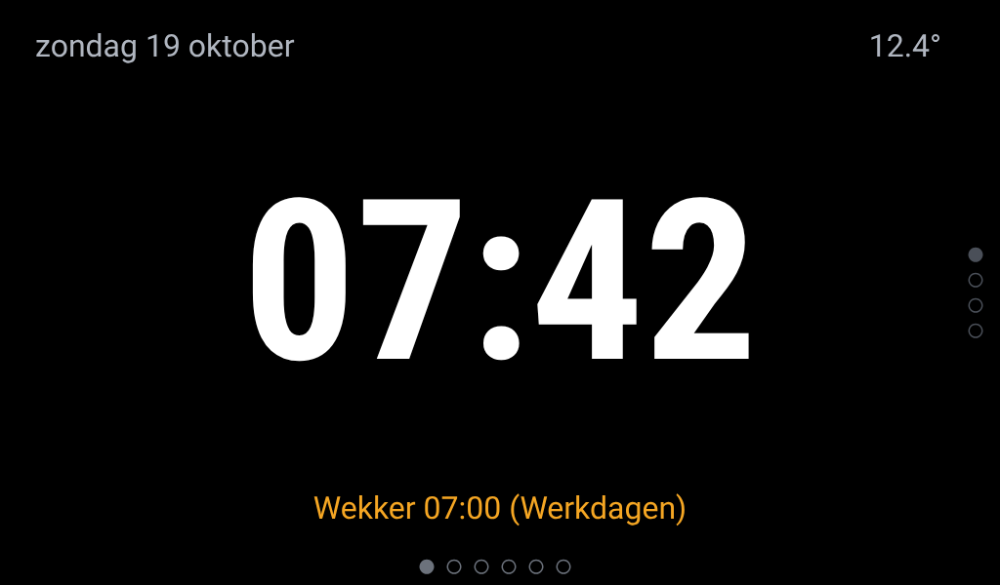
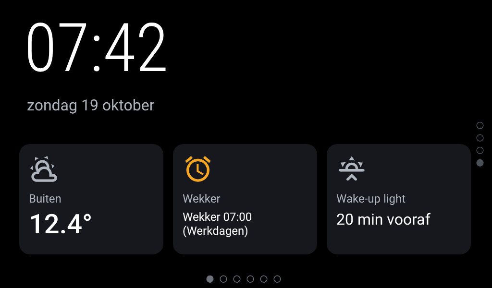
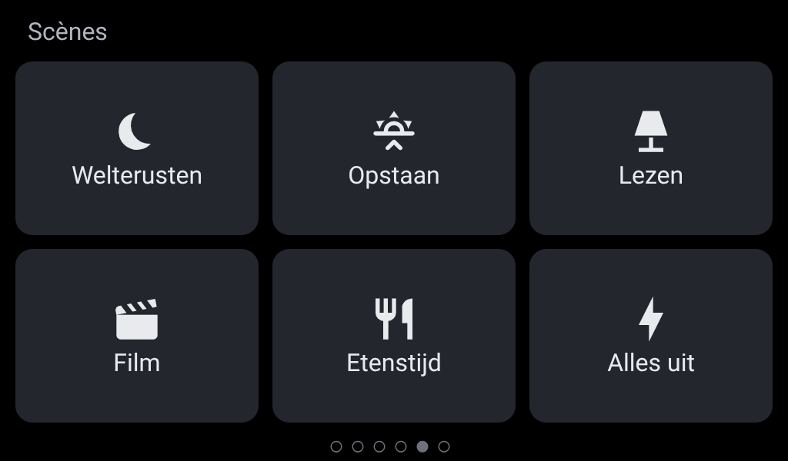

# Alarmklok + domotica-controller

Een wekker voor op het nachtkastje die tegelijk je Home Assistant bedient.
Gebouwd met [ESPHome](https://esphome.io) en LVGL op een **Waveshare
ESP32-P4-WIFI6-Touch-LCD-7B** (7" IPS-touchscreen van 1024×600, liggend).


## Bediening: swipen zoals de iPhone-slaapmodus

| Gebaar | Wat gebeurt er |
|---|---|
| **Links/rechts swipen** | Bladeren tussen Klok → Verlichting → Klimaat & rolluik → Muziek → Scènes → Wekker |
| **Omlaag/omhoog swipen op de klok** | Ander klokontwerp: Digitaal, Analoog, Gestapeld of Info. De keuze wordt onthouden. |
| 30 s niets aanraken | Terug naar de klok |

De stippen onderaan geven aan op welke pagina je bent; de stippen rechts op de
klok geven aan welk klokontwerp actief is. Je kunt het ontwerp ook vanuit Home
Assistant kiezen met `select.alarmklok_klokontwerp`.

## Wat kan hij?

| | |
|---|---|
|  |  |
| **Digitaal:** grote tijd, datum, temperatuur, volgende wekker | **Analoog:** wijzerplaat met secondewijzer, info ernaast |
|  |  |
| **Gestapeld:** uren boven minuten, zoals StandBy | **Info:** tijd met kaarten voor weer, wekker en wake-up light |
|  |  |
| **Verlichting:** 6 tegels (oranje = aan) en een dimschuif | **Klimaat & rolluik:** thermostaat ± 0,5° en rolluik open/stop/dicht/positie |
|  |  |
| **Muziek:** wat er speelt, bediening, volume en 3 radiozenders | **Scènes:** 6 knoppen voor scènes en scripts |
|  |  |
| **Wekker:** tijd, aan/uit, dagen, geluid, volume, wake-up light | **Wekker gaat af:** grote Snooze-knop; Stop moet je lang indrukken |

> De screenshots zijn **ontwerpweergaven**, nagebouwd met dezelfde maten,
> lettertypen, iconen en kleuren als de LVGL-configuratie, met voorbeelddata.
> Het echte scherm kan op kleine details afwijken.

Verder:

- **Nachtstand** ([screenshot](docs/screenshots/11-nachtstand.png)):
  tussen twee instelbare tijden wordt het scherm gedimd en worden alle cijfers
  donkerrood. De eerste tik wekt alleen het scherm, zodat je in het donker niet
  per ongeluk een lamp aanzet.
- **Wake-up light:** een instelbaar aantal minuten voor de wektijd laat Home
  Assistant de bedlamp langzaam opkomen, als een zonsopgang.
- **Wekgeluid:** drie ingebouwde melodieën, of **Radio**: dan speelt Home
  Assistant een radiostream af via de speaker van de klok. Speelt er na 20 s
  nog niets, dan valt de klok terug op het gewone wekgeluid.
- **Speaker in Home Assistant:** de klok verschijnt als mediaspeler, dus je kunt
  er ook muziek, radio of TTS-meldingen naartoe sturen.
- **Werkt zonder Home Assistant:** de tijd komt via NTP en de wekker draait op
  de klok zelf. Als HA plat ligt, gaat de wekker gewoon af.

## Benodigdheden

| Onderdeel | Opmerking |
|---|---|
| Waveshare ESP32-P4-WIFI6-Touch-LCD-7B | Versie zonder camera is genoeg |
| Kleine speaker (4–8 Ω, 2–3 W) | Op de speakeraansluiting van het bord |
| USB-C-voeding (5 V, 2 A) | |
| Behuizing / standaard | Bijvoorbeeld 3D-geprint |

## Mappen

```
esphome/
  alarmklok.yaml                 Instellingen, tegels en wekker-logica (hier pas je dingen aan)
  alarmklok.h                    Hulpfuncties in C++ (datum, wekdagen, melodieën)
  secrets.yaml.example           Voorbeeld voor je wifi-gegevens en sleutels
  onderdelen/
    waveshare-p4-7b.yaml         Hardware: scherm, touch, backlight, audio, wifi
    scherm.yaml                  De touch-interface (swipe-pagina's, klokontwerpen)
    ha-bediening.yaml            Haalt thermostaat, rolluik en muziek uit HA
    tegel.yaml                   Eén bedieningstegel
    tegel-status.yaml            Haalt de status van een tegel uit HA
    radio-knop.yaml              Eén radiozender-knop
docs/screenshots/                Ontwerpweergaven van alle schermen
homeassistant/
  packages/alarmklok.yaml        Automations: wake-up light, radio, goedemorgen
  dashboard-kaart.yaml           Kaart voor je HA-dashboard
```

## Installatie

### 1. Firmware op de klok zetten

1. Installeer de **ESPHome Device Builder**-add-on in Home Assistant, of
   `pip install esphome` op je computer.
2. Kopieer de map `esphome/` naar je ESPHome-configuratiemap. In de add-on is
   dat `/config/esphome/`. Houd de map `onderdelen/` erbij.
3. Maak `secrets.yaml` aan op basis van `secrets.yaml.example` en vul je wifi
   in. Een API-sleutel maak je zo aan:
   ```
   python3 -c "import secrets,base64;print(base64.b64encode(secrets.token_bytes(32)).decode())"
   ```
4. Pas in `alarmklok.yaml` het blok `substitutions:` aan: lampen, thermostaat,
   rolluik, mediaspeler, radiozenders, scènes en de temperatuursensor.
5. De eerste keer flash je via USB-C:
   `esphome run alarmklok.yaml`, of in de add-on via *Install → Plug into this
   computer*. Daarna gaat het draadloos (OTA).

> **Chiprevisie:** de configuratie gaat uit van een productiechip (rev3). Toont
> het bootlog `chip revision: v1.x`? Zet dan in
> `onderdelen/waveshare-p4-7b.yaml` de optie `engineering_sample: true`.

### 2. Koppelen aan Home Assistant

1. HA vindt de klok vanzelf (*Instellingen → Apparaten & diensten*). Voer bij
   het koppelen de API-sleutel in.
2. Open bij de ESPHome-integratie de **opties van de klok** en zet
   **"Sta het apparaat toe Home Assistant-acties uit te voeren"** aan.
   Zonder deze optie doen de tegels en de dimschuif niets.

### 3. Home Assistant-pakket

1. Zet in `configuration.yaml`:
   ```yaml
   homeassistant:
     packages: !include_dir_named packages
   ```
2. Kopieer `homeassistant/packages/alarmklok.yaml` naar `/config/packages/`.
3. Pas de entiteiten in de `variables:`-blokken aan: bedlamp, rolluik en
   radiostream.
4. Herstart Home Assistant.

### 4. Dashboard (optioneel)

Dashboard bewerken → *Kaart toevoegen* → *Handmatig* → plak de inhoud van
`homeassistant/dashboard-kaart.yaml`.

## Entiteiten in Home Assistant

| Entiteit | Wat |
|---|---|
| `time.alarmklok_wektijd` | Wektijd |
| `switch.alarmklok_wekker_aan` | Wekker aan/uit |
| `select.alarmklok_wekdagen` | Elke dag / Werkdagen / Weekend |
| `select.alarmklok_wekgeluid` | Klassiek / Zacht / Mario / Radio |
| `number.alarmklok_wekvolume` | Volume van het wekgeluid |
| `number.alarmklok_snooze_duur` | Snooze in minuten |
| `number.alarmklok_wake_up_light_vooraf` | Minuten voor de wektijd dat het licht begint (0 = uit) |
| `time.alarmklok_nachtstand_vanaf` / `_tot` | Venster voor de nachtstand |
| `number.alarmklok_helderheid_overdag` / `_s_nachts` | Schermhelderheid |
| `light.alarmklok_schermhelderheid` | Backlight rechtstreeks |
| `select.alarmklok_klokontwerp` | Digitaal / Analoog / Gestapeld / Info |
| `sensor.alarmklok_wekker_status` | Wacht / Gaat af / Snooze |
| `button.alarmklok_snooze`, `button.alarmklok_wekker_stoppen`, `button.alarmklok_wekker_testen` | Bediening op afstand |
| `media_player.alarmklok_speaker` | Speaker voor muziek, radio en TTS |

### Events voor eigen automations

| Event | Data |
|---|---|
| `esphome.alarmklok_wakeup` | `minuten`: duur van het wake-up light |
| `esphome.alarmklok_wekker` | `status`: `gaat_af`, `snooze` of `gestopt`, en bij `gaat_af` ook `geluid` |

## Pagina's aanpassen

Alles staat bovenin `esphome/alarmklok.yaml`:

```yaml
  # Verlichting: een tik doet homeassistant.toggle
  licht_1_naam: Bedlamp
  licht_1_entity: light.slaapkamer
  licht_1_icoon: "\U000F095F"   # desk-lamp
  dim_lamp: light.slaapkamer     # voor de dimschuif

  # Klimaat & rolluik
  thermostaat: climate.slaapkamer
  rolluik: cover.slaapkamer

  # Muziek
  mediaspeler: media_player.alarmklok_speaker
  radio_1_naam: NPO Radio 2
  radio_1_url: https://icecast.omroep.nl/radio2-bb-mp3

  # Scènes: een tik doet homeassistant.turn_on
  scene_1_naam: Welterusten
  scene_1_entity: script.welterusten
  scene_1_icoon: "\U000F0904"   # power-sleep
```

Tegels op de pagina Verlichting werken met `light`, `switch`, `fan`, `cover`,
`input_boolean` en dergelijke. Scèneknoppen werken met `scene`, `script` en
`automation`. Heb je een entiteit niet? Laat de tegel dan wijzen naar iets dat
je wel hebt; een tegel naar een onbekende entiteit doet niets.

Na een wijziging moet je de klok opnieuw flashen. Dat gaat draadloos.

### Beschikbare iconen

| Code | Icoon | Code | Icoon |
|---|---|---|---|
| `\U000F0335` | lightbulb | `\U000F075A` | music |
| `\U000F1253` | lightbulb-group | `\U000F0439` | radio |
| `\U000F0769` | ceiling-light | `\U000F04C3` | speaker |
| `\U000F08DD` | floor-lamp | `\U000F0502` | television |
| `\U000F095F` | desk-lamp | `\U000F0210` | fan |
| `\U000F06B5` | lamp | `\U000F0438` | radiator |
| `\U000F00AC` | blinds | `\U000F0393` | thermostat |
| `\U000F111C` | window-shutter | `\U000F0904` | power-sleep |
| `\U000F1A6B` | roller-shade | `\U000F0594` | weather-night |
| `\U000F1846` | curtains | `\U000F059C` | weather-sunset-up |
| `\U000F02DC` | home | `\U000F140B` | lightning-bolt |
| `\U000F06E8` | lightbulb-on | `\U000F0FCE` | movie-open |
| `\U000F04B9` | sofa | `\U000F0A70` | silverware-fork-knife |
| `\U000F02E3` | bed | `\U000F043B` | radio-tower |

Wil je een ander icoon van [Material Design Icons](https://pictogrammers.com/library/mdi/)?
Voeg de code dan ook toe aan de lijst `glyphs:` van het font `f_icoon` in
`onderdelen/scherm.yaml`.

## Bekende aandachtspunten

- Deze configuratie is gevalideerd met `esphome config` (ESPHome 2026.9), maar
  **nog niet op echte hardware getest**. Bij de eerste keer flashen kan er nog
  iets bijgesteld moeten worden.
- **Touch omgekeerd of gespiegeld?** Voeg in `onderdelen/waveshare-p4-7b.yaml`
  onder `touchscreen:` een `transform:` toe (`mirror_x`, `mirror_y`,
  `swap_xy`).
- **Wifi:** loopt via de ESP32-C6 op het bord, met de standaard SDIO-pinnen van
  Espressif voor de ESP32-P4. Komt er geen wifi-verbinding? Controleer dan de
  pinnen onder `esp32_hosted:`, en of de firmware van de C6 actueel is.
- **Flash:** het bord heeft 32 MB, maar de configuratie gebruikt 16 MB, omdat
  OTA met 32 MB in ESPHome nog experimenteel is.
