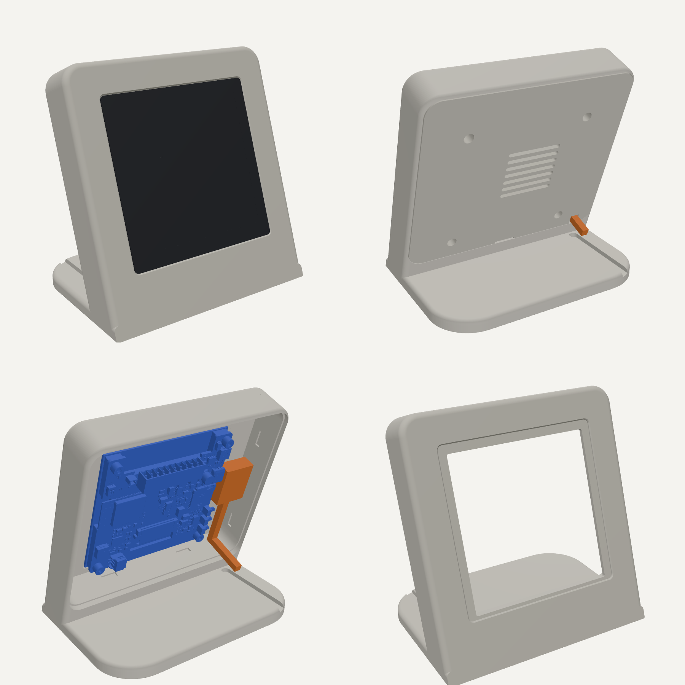

# Behuizing 4"-klok voor op het nachtkastje

Voor het Waveshare **ESP32-S3-Touch-LCD-4** (board V4). Het scherm staat 20° achterover en de
voet zit aan de voorkant vast: samen één printdeel. Het scherm zit **op z'n kop**
(klemmenstrook boven, USB-C links van voren gezien); zet daarom `draaiing: "180"` in je
klokbestand.

Het glas ligt bijna vlak in de voorkant (0,3 mm verzonken), zonder rand eroverheen, op een
randje erachter. Naast het scherm is 14 mm ruimte voor een forse **haakse USB-C-stekker met de
kabel naar beneden**: de kabel loopt binnen langs de linkerwand omlaag, onderin naar achteren
en via een inkeping onderaan de achterklep in het kabelgootje van de voet.



## Onderdelen

| Bestand | Printen | Maat |
|---|---|---|
| `behuizing.stl` | met de voorkant op het bed (de voet staat dan schuin omhoog), zonder support | 117 × 83 × 120 mm |
| `achterklep.stl` | met de buitenkant op het bed, haakjes omhoog | 114 × 101 mm |

De STEP-bestanden zijn dezelfde onderdelen, om in CAD aan te passen. PETG is aan te raden
(de klikhaakjes veren beter dan bij PLA); 0,2 mm laaghoogte en 3 wanden.

## Benodigd

- 4 × **M2,5 × 5** (cilinderkop): het scherm op de achterklep.
- 4 × rubber voetje Ø 10 mm (optioneel, er zitten uitsparingen van 1 mm in de voet).
- Verder geen schroeven: de achterklep klikt met 8 haakjes in de behuizing.

## In elkaar zetten

1. Leg de kabel: van achteren onder door de inkeping linksonder (van voren gezien) en
   langs de linkerwand omhoog naar de plek van de USB-C-aansluiting.
2. Klik de achterklep erop.
3. Steek de haakse stekker in het scherm, kabel naar beneden.
4. Zet het scherm van voren erin: houd het haaks op de voorkant, steek de USB-kant met de
   stekker als eerste naar binnen en draai het scherm om de linkerrand van het glas dicht
   tot het glas op het randje ligt.
5. Leg de klok op zijn voorkant en draai de vier M2,5-schroefjes door de achterklep in de
   afstandsbussen van het scherm. Die trekken het glas op het randje.

Loshalen: schroefjes eruit, het scherm eruit draaien, en de klep met het inkepinkje aan de
onderkant eraf wippen.

## Maten

Alle maten van het bord komen uit het 3D-model en de maattekening van Waveshare
(wiki ESP32-S3-Touch-LCD-4): glas 84,2 × 84,2 × 0,7 mm met hoeken van R2,3, totale diepte
15 mm, afstandsbussen M2,5 op 66,5 × 68,5 mm. Gemeten: de stekkerkop steekt 13 mm buiten
de glasrand uit.

Aanpassen kan in `case.py`: bovenaan staan alle maten, o.a. `PLUG_LEN`, `PLUG_T`,
`PLUG_DOWN` en `CABLE_D` voor de stekker en kabel, en `TILT` voor de hoek. Opnieuw genereren:

```bash
pip install cadquery
python case.py .
```
